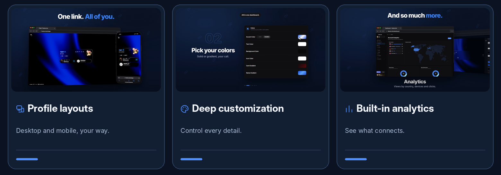

# flexbio.link

**Your link in bio should look like you.**

A free, deeply customizable home for your links, music, socials and everything that makes you *you*.

  &nbsp;
  &nbsp;
  &nbsp;
  &nbsp;
  

Click the animated preview to watch the full 27-second showcase.

## One link. All of you.

Go from a simple bio page to a full personal space. Build the look you want, bring in your favorite platforms, and share everything under one memorable URL.

- **Design without limits.** Personalize layouts, fonts, gradients, backgrounds, cards, banners and visual details.
- **Bring it to life.** Add entrance animations, cursor trails, reactive effects, glowing borders and motion.
- **Make it sound like you.** Upload tracks, display synchronized lyrics and choose your own music player.
- **Stay connected.** Show Discord presence, Spotify, GitHub, TikTok, Twitch, gaming profiles, weather and more with live widgets.
- **Go beyond a bio.** Build a portfolio with projects, skills, galleries, embeds and custom sections.
- **Understand your audience.** Track visits, link clicks, devices and top countries with built-in analytics.

## A closer look

  

## More ways to make it yours

**Multiple profiles** — Keep up to **5 independent profile versions** and choose the active one.

**Your media, in one place** — Built-in image hosting, custom fonts, video backgrounds, music and personal assets.

**Share it your way** — Use `flexbio.link/yourname`, `yourname.flexbio.link`, rich social previews and supported aliases.

**Your creative toolkit** — Explore community templates, experiment in the [Playground](https://flexbio.link/playground) and manage everything from the dashboard.

**Free at the core** — No forced watermarks or paid gates for essential profile customization. Shop badges and marketplace items are optional extras.

## Ready to build yours?

Create an account, claim a username, customize your page and share the result. Saved changes appear on your live profile without a separate publishing step.

 

[Documentation](https://help.flexbio.link) · [Discord Community](https://discord.gg/9uMvPApkfH) · [Service Status](https://status.flexbio.link)

Everything should be free.

