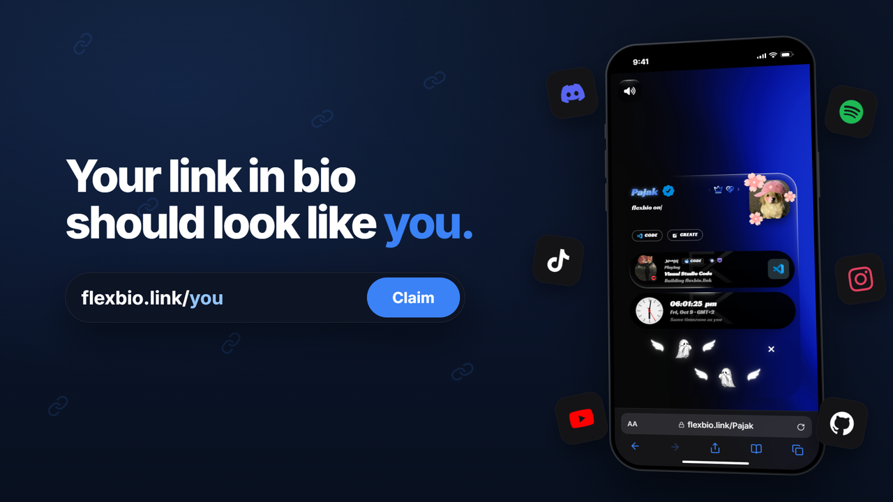

<div align="center">

# flexbio.link

**Your link in bio should look like you.**

Build a profile that goes beyond a list of links — with your own layout, music, live widgets, visuals, and personality.

**Free to create. Free to customize. No forced branding.**

<p>
  <a href="https://flexbio.link"></a>
  <a href="https://help.flexbio.link"></a>
  <a href="https://discord.gg/9uMvPApkfH"></a>
</p>

<a href="./assets/flexbio-ad-16x9.mp4" title="Watch the flexbio.link showcase video">
  
</a>

<sub>▶ Click the banner to watch the 27-second showcase</sub>

</div>

<br>

## One link. All of you.

Your profile shouldn't look like everyone else's. Start with a username, a bio, and a few links. Then make the entire experience your own — from the first animation to the last detail.

No premium plan is required to unlock profile customization. Optional badges, Credits, and marketplace items are separate extras.

<table>
  <tr>
    <td width="50%" valign="top">
      <h3>🎨 Your design, your rules</h3>
      Choose from different profile layouts, including a full portfolio. Set custom colors, gradients, fonts, cards, banners, and backgrounds.
    </td>
    <td width="50%" valign="top">
      <h3>✨ Every detail can move</h3>
      Add entrance screens, animated backgrounds, username effects, interactive cards, cursor trails, click effects, and glowing borders.
    </td>
  </tr>
  <tr>
    <td valign="top">
      <h3>🎧 A profile with a soundtrack</h3>
      Upload music, select a player style, display synchronized lyrics, and bring tracks to life with an audio visualizer.
    </td>
    <td valign="top">
      <h3>🌐 Your world, connected</h3>
      Bring in Discord presence, Spotify, GitHub, YouTube, Twitch, TikTok, gaming profiles, clocks, weather, and more through live widgets.
    </td>
  </tr>
  <tr>
    <td valign="top">
      <h3>🔗 More than ordinary links</h3>
      Add social icons, custom buttons, copyable usernames, galleries, embeds, projects, and portfolio sections.
    </td>
    <td valign="top">
      <h3>📈 Know your audience</h3>
      Explore profile views, link clicks, device data, and countries from your built-in analytics dashboard.
    </td>
  </tr>
</table>

## Make it personal. Keep it flexible.

| | What you get |
| :-- | :-- |
| **Multiple profiles** | Create up to **5 independent profile versions** and choose which one is live. |
| **Layouts & portfolio** | Switch between compact bio layouts, tabbed pages, sidebars, and a project-focused portfolio. |
| **Live widgets** | Connect your favorite platforms and display content that updates on your page. |
| **Your own assets** | Upload fonts, images, videos, music, custom icons, and decorations. |
| **Smart sharing** | Use `flexbio.link/yourname` or `yourname.flexbio.link`, customize link previews, and share a QR code. Aliases are available where supported. |
| **No watermark** | Let your page represent you, without mandatory flexbio branding. |

## More tools, same dashboard.

**[Playground](https://flexbio.link/playground)** — Experiment with layouts, colors, fonts, and effects without touching your live profile.

**[Templates](https://help.flexbio.link/tools/templates)** — Discover community designs, apply a look, or share your own.

**[Image Host](https://help.flexbio.link/tools/image-host)** — Upload and organize media with built-in hosting and direct links.

**[Analytics](https://help.flexbio.link/tools/analytics)** — Track how visitors discover and interact with your profile.

**[Compare features](https://flexbio.link/compare)** — Explore the current layouts, widgets, effects, and free features in detail.

## Your page is just a few clicks away.

1. **[Create an account](https://flexbio.link/register)** and claim a username.
2. Add your **bio, socials, and links**.
3. Pick a **layout** and customize the experience.
4. Add **music, widgets, and effects** if you want.
5. Share your page — changes are reflected on your live profile.

```text
flexbio.link/yourname
yourname.flexbio.link
```

<div align="center">

### Make something that feels like you.

<a href="https://flexbio.link"></a>

<br><br>

[Website](https://flexbio.link) · [Help Center](https://help.flexbio.link) · [Discord](https://discord.gg/9uMvPApkfH) · [Service Status](https://status.flexbio.link) · [Partners](https://flexbio.link/partners)

<sub>Everything should be free. — flexbio.link</sub>

</div>
