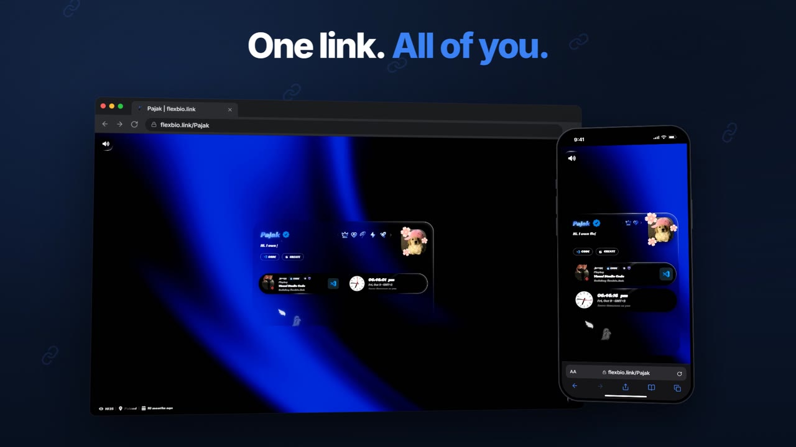
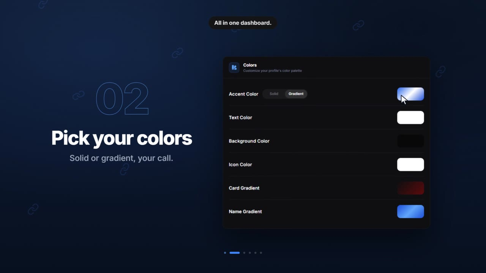
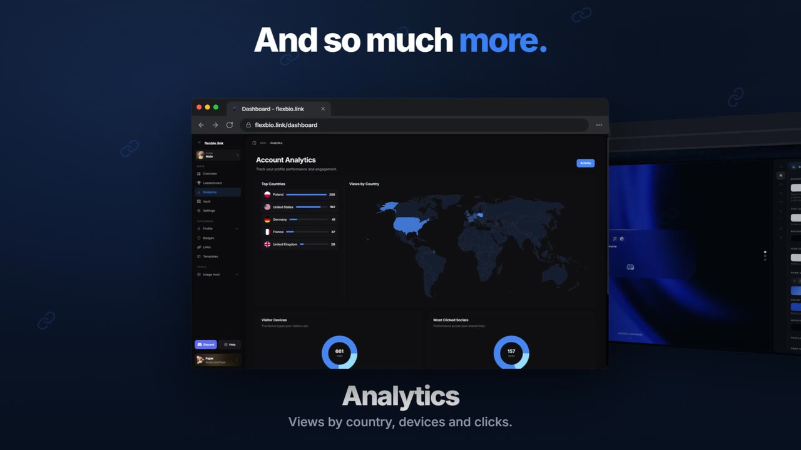

# flexbio.link

### Your link in bio should look like you.

A home for your links, music, socials and everything that makes you **you**.  
Designed your way. Free to create and customize.

  

  <a href="https://help.flexbio.link">Documentation</a>
  &nbsp;·&nbsp;
  <a href="https://discord.gg/9uMvPApkfH">Discord</a>
  &nbsp;·&nbsp;
  <a href="https://status.flexbio.link">System Status</a>

27 seconds of flexbio. Click the showcase to watch it with sound.

## One link. All of you.

Not another copy-paste bio template. Make a clean page for your links, build an animated profile, or turn your space into a full portfolio. The layout, the look and the experience are yours to decide.

**Design your identity.** Choose your layout, colors, gradients and typography. Add backgrounds, banners, custom fonts, profile decorations and your own media.

**Bring it to life.** From subtle entry animations to interactive cards, animated borders, cursors and page effects — choose as much or as little motion as you like.

**Sound, on display.** Upload tracks, choose a music player, show synchronized lyrics and add an audio visualizer.

**Your world, in one place.** Bring Discord presence, Spotify, GitHub, Twitch, TikTok, gaming profiles and more into your page through live widgets.

## A closer look

Three moments from the flexbio experience — a finished profile, the customization dashboard and built-in analytics.

  &nbsp;
  &nbsp;
  

## More than a profile

- **Layouts that fit your content.** Classic bio cards, tabs, sidebars, open widgets and a dedicated portfolio layout for projects and skills.
- **Five profile versions.** Keep up to **5 independent designs** under one account and choose which one is public.
- **Tools built in.** Analytics, image hosting, community templates and a [Playground](https://flexbio.link/playground) where you can try new designs without changing your live page.
- **Sharing that feels personal.** Use `flexbio.link/yourname` or `yourname.flexbio.link`, create custom link previews, and share via a QR code. Aliases are available where supported.
- **No forced branding.** Core profile creation and customization are free. Shop, badges and marketplace extras are optional.

## Make it yours

Claim your username, add what matters, customize every detail and share your page. Changes to your profile go live as soon as you save them.

  <a href="https://flexbio.link/compare">Explore features</a>
  &nbsp;·&nbsp;
  <a href="https://help.flexbio.link">Help Center</a>
  &nbsp;·&nbsp;
  <a href="https://discord.gg/9uMvPApkfH">Community</a>
  &nbsp;·&nbsp;
  <a href="https://status.flexbio.link">System Status</a>

Everything should be free.

