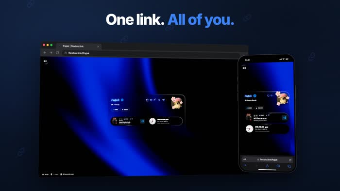
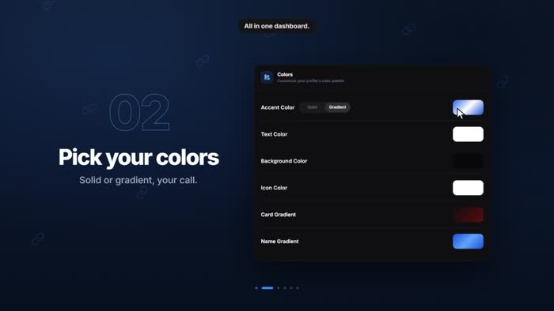
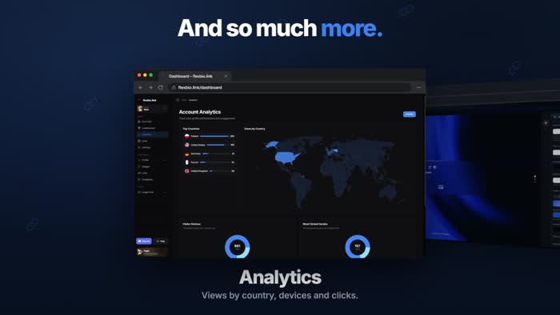

<div align="center">

# flexbio.link

### your profile, without the template feeling.

Build a link-in-bio page that actually feels like **you** — with custom layouts, music, live widgets, motion, analytics and a full portfolio layout.

<p>
  <a href="https://flexbio.link"> Website</a>
  &nbsp;&nbsp;•&nbsp;&nbsp;
  <a href="https://help.flexbio.link"> Documentation</a>
  &nbsp;&nbsp;•&nbsp;&nbsp;
  <a href="https://discord.gg/9uMvPApkfH"> Discord</a>
  &nbsp;&nbsp;•&nbsp;&nbsp;
  <a href="https://status.flexbio.link"> Status</a>
  &nbsp;&nbsp;•&nbsp;&nbsp;
  <a href="https://flexbio.link/compare"> Compare</a>
</p>

<a href="./assets/flexbio-ad-16x9.mp4" title="Open the full showcase video">
  
</a>

<sub><strong>Click the preview</strong> to open the full 27-second showcase video.</sub>

</div>

## One link. All of you.

Your profile should not look like everyone else's.

Start with a username, avatar, bio and links. Then turn it into something personal with layouts, fonts, effects, media, widgets and polished sharing.

-  **Deep customization** — colors, gradients, fonts, cards, banners, backgrounds and profile styling.
-  **Motion & effects** — entrance screens, animated borders, cursor effects, click effects and more.
-  **Built for music** — upload tracks, add lyrics, choose player styles and enable audio visuals.
-  **Live widgets** — Discord, Spotify, GitHub, Twitch, TikTok, clocks, weather, galleries and more.
-  **Useful tools** — analytics, templates, image hosting, playground and multiple profile versions.

## A quick look inside

<p align="center">
  
  
  
</p>

<p align="center">
  <sub><strong>Profile layouts</strong> · Clean bio pages, open widgets, sidebars and portfolio-style setups.</sub><br>
  <sub><strong>Deep customization</strong> · Fine-tune colors, gradients and visual identity directly in the dashboard.</sub><br>
  <sub><strong>Built-in tools</strong> · Analytics, media hosting, templates and more — all in one place.</sub>
</p>

## What you get

-  **Up to 5 independent profile versions** in one account.
-  **Clean share links** with `flexbio.link/yourname` and `yourname.flexbio.link`.
-  **No forced branding or watermark** on your profile.
-  **Flexible layouts** from simple bio pages to full portfolio layouts.
-  **Your own assets** — fonts, images, videos, music and custom icons.
-  **Better sharing** with custom previews, aliases and QR-friendly links.

Optional shop items, badges and marketplace extras stay optional — the core builder and customization remain free.

## Get started

1. Go to **[flexbio.link](https://flexbio.link)** and claim your username.
2. Add your bio, socials and links.
3. Pick a layout and style it your way.
4. Drop in music, widgets and effects if you want.
5. Share your page — changes go live instantly.

```text
flexbio.link/yourname
yourname.flexbio.link
```

<div align="center">

### Make it feel like you.

<a href="https://flexbio.link">Create your profile</a>
&nbsp;&nbsp;•&nbsp;&nbsp;
<a href="https://help.flexbio.link">Read the docs</a>
&nbsp;&nbsp;•&nbsp;&nbsp;
<a href="https://discord.gg/9uMvPApkfH">Join the community</a>

<br><br>

**Everything should be free.**

</div>
